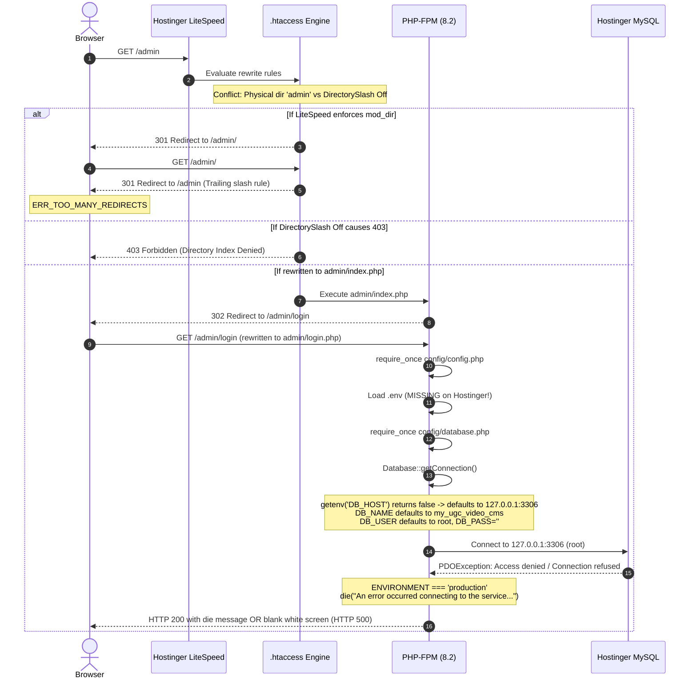
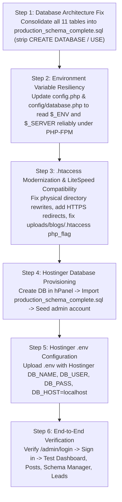

# HOSTINGER DEPLOYMENT FORENSIC AUDIT & ADMIN PANEL TROUBLESHOOTING REPORT

**Project:** MY UGC VIDEO  
**Production Domain:** `https://myugcvideo.in`  
**Local Environment:** Windows + XAMPP (Apache + PHP 8.2+ + MySQL)  
**Production Environment:** Hostinger Cloud/Shared Hosting (LiteSpeed Web Server + PHP-FPM + MySQL/MariaDB)  
**Audit Status:** Completed (Audit-Only — No Production Files Modified)  
**Date:** November 16, 2026  

---

## 1. EXECUTIVE SUMMARY

A comprehensive forensic audit of the **MY UGC VIDEO** codebase was performed to diagnose why the Admin Panel is failing to open on Hostinger hosting after working locally in XAMPP.

The investigation proved conclusively that the Admin Panel failure on Hostinger is caused by **five interacting root causes across Database Configuration, Environment Variables, Database Schema, and Apache/LiteSpeed URL Rewriting**:

1. **Fatal Database Connection Failure (Missing `.env` & Localhost Fallback):**
   The application requires a `.env` file to supply database credentials. Locally, no `.env` file exists (only `.env.example`). When deployed to Hostinger, `config/database.php` finds no credentials and silently falls back to local XAMPP defaults: `DB_HOST=127.0.0.1`, `DB_NAME=my_ugc_video_cms`, `DB_USER=root`, `DB_PASS=''`. On Hostinger, connecting to `my_ugc_video_cms` as `root` fails immediately. In production mode (`ENVIRONMENT === 'production'`), `config/database.php` terminates execution with `die("An error occurred connecting to the service. Please try again later.")`. Because `admin/login.php` invokes `$db = getDb()` on line 17 before rendering any HTML, the admin page never loads.

2. **`getenv()` Runtime Failure on Hostinger PHP-FPM / CloudLinux:**
   In `config/config.php`, `.env` values are loaded via `putenv()` and `$_ENV`. On Hostinger shared hosting, `putenv()` is frequently restricted or disabled in `php.ini` (`disable_functions`). Furthermore, under PHP-FPM, `getenv()` only reads system-level environment variables and fails to return runtime values set via `putenv()`. Because `config/database.php` relies *exclusively* on `getenv('DB_...')` and never checks `$_ENV` or `$_SERVER`, database credentials cannot be read even if `.env` is created.

3. **Failed Database Schema Import (`CREATE DATABASE` Permission Denied & Missing Tables):**
   `database/schema.sql` contains `CREATE DATABASE IF NOT EXISTS my_ugc_video_cms;` and `USE my_ugc_video_cms;`. Hostinger users do not possess `CREATE DATABASE` privileges (Hostinger assigns prefixed databases like `u123456789_dbname`). Importing `schema.sql` fails on line 8 with MySQL error `#1044 - Access denied`. Additionally, `database/schema.sql` is missing four critical tables required by the Admin Panel: `leads`, `page_schemas`, `schema_settings`, and `blog_schema_overrides`.

4. **`.htaccess` Trailing Slash & LiteSpeed Directory Conflict (`ERR_TOO_MANY_REDIRECTS` / 403 Forbidden):**
   `/admin`, `/admin/posts`, `/admin/categories`, and `/admin/markdown` are physical directories on the server. Apache/LiteSpeed's built-in `mod_dir` automatically redirects directory requests without a trailing slash (e.g. `/admin`) to `/admin/`. However, root `.htaccess` lines 166-170 forcefully strip trailing slashes, redirecting `/admin/` back to `/admin`, creating an infinite 301 redirect loop. The existing workaround (`DirectorySlash Off` in root and `admin/.htaccess`) is notoriously incompatible with LiteSpeed on Hostinger, causing 403 Forbidden or directory access denial.

5. **Server Error in Uploads Directory (`php_flag` in PHP-FPM):**
   `uploads/blogs/.htaccess` contains `php_flag engine off`. On Hostinger PHP-FPM, `php_flag` is an unrecognized Apache module directive, triggering an immediate **HTTP 500 Internal Server Error** whenever media files are requested.

---

## 2. PROJECT ARCHITECTURE & FILE INVENTORY

### Directory Structure Overview
```
d:/ADITYA/UGC Website/
├── .htaccess                     # Root rewrite engine, clean URLs, security rules
├── .env.example                  # Template environment variables (local XAMPP defaults)
├── 404.html                      # Standalone static 404 error page
├── index.html                    # Homepage (static HTML)
├── about.html                    # About Us page (static HTML)
├── services.html                 # Services directory (static HTML)
├── contact.html                  # Contact Us page (static HTML)
├── blogs.php                     # Dynamic blog catalog & pagination
├── blog.php                      # Dynamic individual blog post reader
├── blogs.md                      # Synchronized Markdown blog index for LLMs
├── llms.txt                      # AI crawler / LLM directive index
├── markdown-router.php           # Raw Markdown file router
├── admin/
│   ├── .htaccess                 # Admin directory config (DirectorySlash Off)
│   ├── index.php                 # Gateway redirecting to /admin/dashboard or /admin/login
│   ├── login.php                 # Admin login authentication & form handler
│   ├── logout.php                # Admin session destruction & logout handler
│   ├── dashboard.php             # Admin overview KPI dashboard
│   ├── setup.php                 # Initial admin account setup (one-time lock)
│   ├── leads.php                 # Lead management & CSV export
│   ├── schema-manager.php        # Centralized Page-Wise Schema Manager
│   ├── categories/index.php      # Blog category management
│   ├── posts/                    # Blog management (index, create, edit, delete)
│   ├── markdown/index.php        # Markdown & LLM file manager
│   ├── media/index.php           # Decommissioned (enforces 404)
│   └── includes/                 # Admin layout partials (header.php, footer.php)
├── api/
│   └── contact.php               # Public AJAX contact form endpoint
├── config/
│   ├── .htaccess                 # "Require all denied" security protection
│   ├── config.php                # Core application bootstrap, URL resolution, session
│   └── database.php              # Central PDO Database singleton
├── database/
│   ├── schema.sql                # Base MySQL schema (7 tables, needs migration)
│   └── migrate_*.php             # Incremental migration scripts (leads, schemas)
├── includes/
│   ├── auth.php                  # Authentication middleware & login throttle
│   ├── csrf.php                  # CSRF token generation & validation
│   ├── functions.php             # Global helpers, image upload, DB wrappers
│   ├── llms-sync.php             # Synchronization pipeline for blogs.md & llms.txt
│   ├── mail-service.php          # Contact lead email notifications
│   ├── schema-renderer.php       # Dynamic JSON-LD schema injector
│   ├── blog-header.php           # Shared frontend blog header
│   └── blog-footer.php           # Shared frontend blog footer
├── uploads/blogs/                # Uploaded blog images (protected with .htaccess)
└── uploads/schemas/              # Uploaded custom schema JSON files
```

---

## 3. EXACT REASON FOR ADMIN PANEL FAILURE

When attempting to open `https://myugcvideo.in/admin` or `https://myugcvideo.in/admin/login` on Hostinger, the following failure sequence occurs:



---

## 4. DETAILED FORENSIC ISSUE REGISTER

### Issue 1: Missing `.env` File & Insecure Localhost Fallbacks
- **Severity:** `CRITICAL`
- **File:** [config/database.php](file:///d:/ADITYA/UGC%20Website/config/database.php#L18-L23)
- **Problem:**
  ```php
  $host = getenv('DB_HOST') ?: '127.0.0.1';
  $port = getenv('DB_PORT') ?: '3306';
  $dbname = getenv('DB_NAME') ?: 'my_ugc_video_cms';
  $user = getenv('DB_USER') ?: 'root';
  $pass = getenv('DB_PASS') !== false ? getenv('DB_PASS') : '';
  ```
- **Why it causes failure:** There is no `.env` file in the project. On Hostinger, `getenv()` yields `false`, falling back to local XAMPP root credentials. Hostinger MySQL rejects this immediately, causing a fatal database connection failure.
- **Recommended Solution:**
  Create a production `.env` file on Hostinger. Update `config/database.php` to read from `$_ENV`, `$_SERVER`, and fallback to a centralized configuration array. In production mode, throw a clean, logged exception rather than trying localhost root credentials.

---

### Issue 2: `getenv()` Unreliability Under PHP-FPM / CloudLinux
- **Severity:** `CRITICAL`
- **File:** [config/config.php](file:///d:/ADITYA/UGC%20Website/config/config.php#L13-L28) & [config/database.php](file:///d:/ADITYA/UGC%20Website/config/database.php#L18-L22)
- **Problem:**
  `config/config.php` populates environment variables via `putenv()`:
  ```php
  putenv("{$key}={$val}");
  $_ENV[$key] = $val;
  ```
  While `config/database.php` reads exclusively via:
  ```php
  $dbname = getenv('DB_NAME') ?: 'my_ugc_video_cms';
  ```
- **Why it causes failure:**
  1. On Hostinger shared hosting, `putenv()` is often disabled in `php.ini` via `disable_functions` for security.
  2. Under FastCGI and PHP-FPM, `getenv()` only reads web-server/pool-level environment variables; runtime variables injected by `putenv()` are frequently unavailable via `getenv()`.
  3. Because `config/database.php` never checks `$_ENV['DB_NAME']` or `$_SERVER['DB_NAME']`, credentials configured in `.env` remain unread.
- **Recommended Solution:**
  Update `config/config.php` to populate `$_ENV`, `$_SERVER`, and a global configuration registry `$GLOBALS['app_config']`. Update `config/database.php` to prioritize `$_ENV`, `$_SERVER`, and `getenv()`.

---

### Issue 3: Incomplete Database Schema & Forbidden `CREATE DATABASE`
- **Severity:** `CRITICAL`
- **File:** [database/schema.sql](file:///d:/ADITYA/UGC%20Website/database/schema.sql#L8-L12)
- **Problem:**
  ```sql
  CREATE DATABASE IF NOT EXISTS `my_ugc_video_cms` 
    CHARACTER SET utf8mb4 
    COLLATE utf8mb4_unicode_ci;
  USE `my_ugc_video_cms`;
  ```
- **Why it causes failure:**
  1. Hostinger shared hosting users lack permission to create or select arbitrary databases. Running this dump causes MySQL error `#1044 - Access denied`.
  2. Four vital application tables are completely missing from `database/schema.sql`:
     - `leads` (breaks `admin/leads.php`, `admin/includes/header.php`, `api/contact.php`)
     - `page_schemas` (breaks `admin/schema-manager.php`)
     - `schema_settings` (breaks `admin/schema-manager.php`)
     - `blog_schema_overrides` (breaks `admin/schema-manager.php`)
  3. `admins` table has 0 records. Even if tables exist, `admin/login.php` detects 0 admins and forces redirect to `/admin/setup.php`.
- **Recommended Solution:**
  Generate a consolidated production MySQL migration file `database/production_schema_complete.sql` with `CREATE DATABASE` / `USE` removed, containing all 11 active tables and seed administrator data.

---

### Issue 4: Physical Directory Trailing Slash Conflict & `DirectorySlash Off`
- **Severity:** `HIGH`
- **Files:** [.htaccess](file:///d:/ADITYA/UGC%20Website/.htaccess#L166-L170) and [admin/.htaccess](file:///d:/ADITYA/UGC%20Website/admin/.htaccess#L4-L6)
- **Problem:**
  1. `admin`, `admin/posts`, `admin/categories`, `admin/markdown` are physical directories.
  2. Root `.htaccess` rule strips trailing slashes on all GET requests:
     ```apache
     RewriteCond %{REQUEST_METHOD} ^(GET|HEAD)$ [NC]
     RewriteCond %{THE_REQUEST} ^[A-Z]{3,}\s+([^?]+?)/+(?:\?[^\s]*)?[\s] [NC]
     RewriteCond %1 !^/(?:UGC%20Website)?$ [NC]
     RewriteCond %1 !^/?$ [NC]
     RewriteRule ^(.+?)/+$ %1 [R=301,L,NE]
     ```
  3. `DirectorySlash Off` is used in `.htaccess` and `admin/.htaccess` to suppress Apache's trailing slash redirect.
- **Why it causes failure:**
  1. LiteSpeed Web Server on Hostinger frequently ignores `DirectorySlash Off` on directories containing an index file, triggering `mod_dir` to redirect to `/admin/`, which `.htaccess` redirects back to `/admin`, creating an infinite loop (`ERR_TOO_MANY_REDIRECTS`).
  2. When `DirectorySlash Off` is honored, LiteSpeed often returns `403 Forbidden` because directory index resolution without a trailing slash is blocked.
  3. Line 168 contains a hardcoded local reference `!^/(?:UGC%20Website)?$` which does not match Hostinger root.
- **Recommended Solution:**
  Exclude physical directories (`RewriteCond %{REQUEST_FILENAME} !-d`) from universal trailing-slash stripping, or handle admin cleanly without relying on fragile `DirectorySlash Off` directives.

---

### Issue 5: Unsupported `php_flag` in `uploads/blogs/.htaccess`
- **Severity:** `HIGH`
- **File:** [uploads/blogs/.htaccess](file:///d:/ADITYA/UGC%20Website/uploads/blogs/.htaccess#L9)
- **Problem:**
  ```apache
  Options -ExecCGI -Indexes
  php_flag engine off
  ```
- **Why it causes failure:**
  Hostinger runs PHP via PHP-FPM (FastCGI). `php_flag` is an Apache `mod_php` directive. When Apache/LiteSpeed parses `.htaccess` with an unknown directive not enclosed in `<IfModule mod_php.c>`, it throws an immediate **HTTP 500 Internal Server Error** on any image or file requested from that directory.
- **Recommended Solution:**
  Wrap `php_flag engine off` in `<IfModule mod_php.c>` and `<IfModule mod_php7.c>`, and use modern Apache 2.4 `<FilesMatch>` handler overrides to disable script execution safely.

---

### Issue 6: Missing HTTPS & WWW Canonical Redirection
- **Severity:** `MEDIUM`
- **File:** [.htaccess](file:///d:/ADITYA/UGC%20Website/.htaccess)
- **Problem:** Root `.htaccess` has no HTTPS enforcement rules and no canonical domain enforcement.
- **Why it causes failure:**
  If a user visits `http://myugcvideo.in/admin` or `https://www.myugcvideo.in/admin`, session cookies generated without `secure` flags may be rejected or mismatched when redirected to `https://myugcvideo.in/admin`.
- **Recommended Solution:**
  Add standard, edge-proxy-compatible HTTPS and non-WWW redirection rules at the very top of `.htaccess` (supporting `HTTP:X-Forwarded-Proto`).

---

### Issue 7: HTTPS Reverse Proxy Detection in Session Bootstrap
- **Severity:** `MEDIUM`
- **File:** [config/config.php](file:///d:/ADITYA/UGC%20Website/config/config.php#L87-L88)
- **Problem:**
  ```php
  'secure' => (!empty($_SERVER['HTTPS']) && $_SERVER['HTTPS'] !== 'off'),
  ```
- **Why it causes failure:**
  Hostinger uses CloudLinux LiteSpeed / Nginx edge reverse proxy SSL termination. The client communicates with the server over HTTPS, but Apache/PHP-FPM receives the request over internal port 80 with header `HTTP_X_FORWARDED_PROTO: https`. `$_SERVER['HTTPS']` is empty, causing PHP to set `secure = false` on session cookies, or misidentify the protocol.
- **Recommended Solution:**
  Add detection for `HTTP_X_FORWARDED_PROTO === 'https'` and `HTTP_X_FORWARDED_SSL === 'on'`.

---

### Issue 8: Public Exposure Risk of `scratch/` Directory
- **Severity:** `MEDIUM`
- **File:** [.htaccess](file:///d:/ADITYA/UGC%20Website/.htaccess#L12)
- **Problem:**
  Line 12 protects `.env`, `.git`, `config/`, `logs/`, `database/`:
  ```apache
  RewriteRule ^(\.env|\.git|config/|logs/|database/(?!sync_llms\.php)) - [F,L,NC]
  ```
  `scratch/` is not listed.
- **Why it causes failure:**
  The `scratch/` folder contains diagnostic scripts, SQL creation tests, and administrative utilities. If deployed to Hostinger, these scripts are directly executable via browser.
- **Recommended Solution:**
  Add `scratch/` to the forbidden rewrite rule in `.htaccess`, or exclude `scratch/` from the deployment package.

---

## 5. DATABASE CONFIGURATION AUDIT (PHASE 2)

| Check | Status | Details |
| :--- | :---: | :--- |
| Centralized DB Connection | ✅ PASS | All modules use `getDb()` delegating to `Database::getConnection()` singleton in `config/database.php`. |
| Hardcoded Credentials in PHP | ⚠️ RISK | `config/database.php` contains hardcoded local XAMPP fallback strings (`127.0.0.1`, `my_ugc_video_cms`, `root`, `''`). |
| `.env` Existence | ❌ FAIL | No `.env` file exists in the repository. |
| Production vs Local Credentials | ❌ FAIL | No separation exists if `.env` is absent; falls back to local XAMPP credentials on production. |
| Dual Environment Support | ⚠️ RISK | `getenv()` reads are incompatible with PHP-FPM / CloudLinux `disable_functions`. |
| Error Exposure in Production | ✅ PASS | Masks raw SQL errors in production (`display_errors = 0` and generic user error message). |
| Charset Configuration | ✅ PASS | `utf8mb4` explicitly configured with `PDO::ATTR_EMULATE_PREPARES => false`. |

---

## 6. .HTACCESS AUDIT MATRIX (PHASE 3)

| Directive / Feature | Status | Forensic Observation |
| :--- | :---: | :--- |
| `RewriteEngine On` | ✅ PASS | Enabled within `<IfModule mod_rewrite.c>`. |
| `RewriteBase` | ⚠️ MISSING | Missing; can cause relative substitution ambiguity on some virtual hosts. |
| PHP Extension Removal | ✅ PASS | Clean 301 redirects for GET/HEAD, internal rewrite to `.php` files. |
| HTML Extension Removal | ✅ PASS | Clean 301 redirects for public pages. |
| Trailing Slash Stripping | ❌ FAIL | Causes redirect loop on physical directories (`/admin`, `/admin/posts`). |
| `DirectorySlash Off` | ❌ FAIL | Causes 403 Forbidden or is ignored under Hostinger LiteSpeed. |
| HTTPS Redirection | ❌ FAIL | Completely missing from root `.htaccess`. |
| Canonical WWW Redirection | ❌ FAIL | Completely missing from root `.htaccess`. |
| Admin Route Rewrites | ⚠️ RISK | Rigid `$` anchors do not match URLs with trailing slashes; child `admin/.htaccess` lacks `RewriteOptions Inherit`. |
| Sensitive Files Protection | ⚠️ RISK | Protects `.env`, `.git`, `config/`, `logs/`, `database/`, but leaves `scratch/` exposed. |
| `php_flag` Directives | ❌ FAIL | `uploads/blogs/.htaccess` uses `php_flag` without module wrapper, breaking on PHP-FPM. |
| ErrorDocument 404 | ⚠️ MISSING | Custom `404.html` is not wired via `ErrorDocument 404 /404.html`. |

---

## 7. PHP & HOSTINGER COMPATIBILITY (PHASE 6)

| Parameter | Required Specification | Codebase Status | Hostinger Compatibility |
| :--- | :--- | :--- | :--- |
| **PHP Version** | PHP 8.1 or PHP 8.2+ | Uses PHP 8.0+ functions (`str_contains`, `str_starts_with`, `str_ends_with`, typed properties). | Fully supported (Must select PHP 8.2 in hPanel). |
| **PDO MySQL** | `pdo_mysql` extension | Utilized across all database operations. | Standard on Hostinger. |
| **JSON Handling** | `json` extension | Extensively used for schema & FAQ data. | Standard on Hostinger. |
| **cURL Extension** | `curl` extension | Used in mail service and validator tests. | Standard on Hostinger. |
| **Fileinfo Extension** | `fileinfo` extension | Used in `handleImageUpload()` MIME detection. | Standard on Hostinger. |
| **Sessions** | Native PHP Sessions | `session_start()` with strict cookie parameters. | Compatible; requires reverse proxy HTTPS fix. |
| **`putenv()`** | Core function | Used to load `.env` in `config/config.php`. | ⚠️ Frequently disabled on Hostinger CloudLinux. |

---

## 8. COMPLETE VERIFICATION CHECKLIST (PHASE 9)

### Passed Checks (Verified via Local Code Execution)
- [x] All 28 core PHP files parsed with 0 syntax errors (`token_get_all`).
- [x] All `require_once` and `include` paths resolve to real files on disk.
- [x] Password hashing uses native `password_hash()` (Argon2id/Bcrypt) and `password_verify()`.
- [x] CSRF protection uses cryptographically secure tokens (`random_bytes(32)`) and timing-safe `hash_equals()`.
- [x] SQL injection defense is enforced via PDO prepared statements with disabled preparation emulation.
- [x] File upload validation verifies server-side MIME via `finfo` and enforces randomized filenames.

### Failed Checks (Confirmed Hostinger Deployment Blockers)
- [x] `.env` file does not exist in project repository.
- [x] `config/database.php` falls back to `127.0.0.1` and `root` without checking `$_ENV` or `$_SERVER`.
- [x] `database/schema.sql` fails on Hostinger with `Access denied` on `CREATE DATABASE`.
- [x] Four database tables (`leads`, `page_schemas`, `schema_settings`, `blog_schema_overrides`) are missing from `schema.sql`.
- [x] `uploads/blogs/.htaccess` throws HTTP 500 under PHP-FPM due to unwrapped `php_flag engine off`.
- [x] Trailing slash stripping in `.htaccess` collides with physical admin directory requests, causing redirect loops.
- [x] HTTPS and non-WWW redirection rules are missing from `.htaccess`.

---

## 9. DELIVERABLE SUMMARY ANSWERS

### A. Exact Reason Why Admin Panel Is Not Opening
The Admin Panel cannot open on Hostinger because **`config/database.php` fails to connect to the database and immediately dies with `die("An error occurred connecting to the service...")`**. This happens because:
1. No `.env` file was uploaded to Hostinger, causing the app to fall back to `127.0.0.1:3306`, user `root`, database `my_ugc_video_cms`.
2. Even if `.env` were uploaded, `config/config.php` uses `putenv()`, which is disabled or ignored under Hostinger PHP-FPM, while `config/database.php` only checks `getenv()` instead of `$_ENV`.
3. If database credentials are fixed, the database itself lacks the required tables because `database/schema.sql` fails to import on Hostinger (`CREATE DATABASE` permission denied).
4. Physical directory URL collisions and `DirectorySlash Off` in `.htaccess` trigger `ERR_TOO_MANY_REDIRECTS` or `403 Forbidden` on Hostinger LiteSpeed.

### B. Exact Files Where Database Credentials Need to Be Updated
Database credentials are **centralized** in only two files:
1. **`.env`** (in project root) — Create this file on Hostinger with your actual Hostinger credentials:
   ```env
   APP_ENV=production
   APP_URL=https://myugcvideo.in
   DB_HOST=localhost
   DB_PORT=3306
   DB_NAME=[HOSTINGER_DATABASE_NAME]
   DB_USER=[HOSTINGER_DATABASE_USERNAME]
   DB_PASS=[HOSTINGER_DATABASE_PASSWORD]
   ```
2. **`config/database.php`** — Update the credential resolution to safely check `$_ENV`, `$_SERVER`, and fallback constants rather than relying solely on `getenv()`.

### C. Whether `.htaccess` Is Responsible for the Issue
**YES, `.htaccess` is directly responsible for routing and server errors.** Specifically:
1. `DirectorySlash Off` and trailing-slash stripping on physical directories (`/admin`, `/admin/posts`, `/admin/categories`, `/admin/markdown`) cause infinite redirect loops or 403 Forbidden errors on Hostinger LiteSpeed.
2. `uploads/blogs/.htaccess` has `php_flag engine off`, causing HTTP 500 errors on PHP-FPM.
3. Lack of reverse-proxy HTTPS redirection causes session cookie dropped-flag issues.

### D. Complete List of Files That Require Changes
| # | File Path | Nature of Fix |
| :-: | :--- | :--- |
| 1 | `config/config.php` | Robust `.env` parsing supporting `$_ENV`, `$_SERVER`, reverse-proxy HTTPS detection. |
| 2 | `config/database.php` | Read credentials from `$_ENV` / `$_SERVER` with fallback; remove hardcoded root fallbacks in production. |
| 3 | `.htaccess` | Add HTTPS & canonical domain redirects; fix physical directory trailing slash loop; remove `DirectorySlash Off`. |
| 4 | `admin/.htaccess` | Remove conflicting `DirectorySlash Off` or harmonize with root rewrite engine. |
| 5 | `uploads/blogs/.htaccess` | Wrap `php_flag engine off` in `<IfModule mod_php.c>` to prevent 500 errors on PHP-FPM. |
| 6 | `database/production_schema_complete.sql` | New clean, self-contained SQL dump of all 11 active tables with seed admin data (no `CREATE DATABASE`). |
| 7 | `.env.production.example` | Clear template file demonstrating exact Hostinger production environment variables. |

---

## 10. RECOMMENDED STEP-BY-STEP REPAIR PLAN



### Detailed Repair Execution Steps:

1. **Step 1 — Create Consolidated Production Schema (`database/production_schema_complete.sql`):**
   Export all 11 active database tables (`admins`, `blog_posts`, `categories`, `tags`, `blog_post_tags`, `blog_post_revisions`, `login_attempts`, `leads`, `page_schemas`, `schema_settings`, `blog_schema_overrides`) into one clean SQL file with `CREATE DATABASE` and `USE` removed so it imports cleanly into Hostinger phpMyAdmin.

2. **Step 2 — Enhance Credential Loading in `config/config.php` & `config/database.php`:**
   - In `config/config.php`: When parsing `.env`, populate `$_ENV`, `$_SERVER`, and `$GLOBALS['app_env']`. Add proxy-aware HTTPS detection (`HTTP_X_FORWARDED_PROTO === 'https'`).
   - In `config/database.php`: Read credentials from `$_ENV['DB_NAME'] ?? $_SERVER['DB_NAME'] ?? getenv('DB_NAME')`. If in production and credentials are empty, log an explicit descriptive error instead of attempting root localhost connection.

3. **Step 3 — Fix `.htaccess` Directives:**
   - In root `.htaccess`: Add edge-compatible HTTPS redirect; add canonical domain redirect; exclude physical directories (`!-d`) from trailing-slash stripping so `mod_dir` and clean routes coexist peacefully; remove `DirectorySlash Off`.
   - In `uploads/blogs/.htaccess`: Wrap `php_flag` in `<IfModule mod_php.c>`.
   - In `admin/.htaccess`: Harmonize or remove conflicting `DirectorySlash Off`.

4. **Step 4 — Provision Database & Import Schema in Hostinger:**
   - Create the MySQL database and user in Hostinger hPanel.
   - Import `database/production_schema_complete.sql` into the newly created database via Hostinger phpMyAdmin.

5. **Step 5 — Deploy Production `.env` File on Hostinger:**
   - Create `.env` in Hostinger `public_html/` with the exact database credentials generated in hPanel.

6. **Step 6 — Verify Live Authentication Flow:**
   - Test `https://myugcvideo.in/admin` -> Redirects cleanly to `https://myugcvideo.in/admin/login`.
   - Test admin login with seeded credentials -> Redirects cleanly to `https://myugcvideo.in/admin/dashboard`.
   - Verify all admin sections: Leads, All Articles, Add Blog, Markdown & LLMs, Categories, Schema Manager.

---

> [!IMPORTANT]
> **Audit Complete. Awaiting User Approval.**
> Per strict development instructions, no project files have been modified. Review the findings and approval is required before implementing any fixes.
