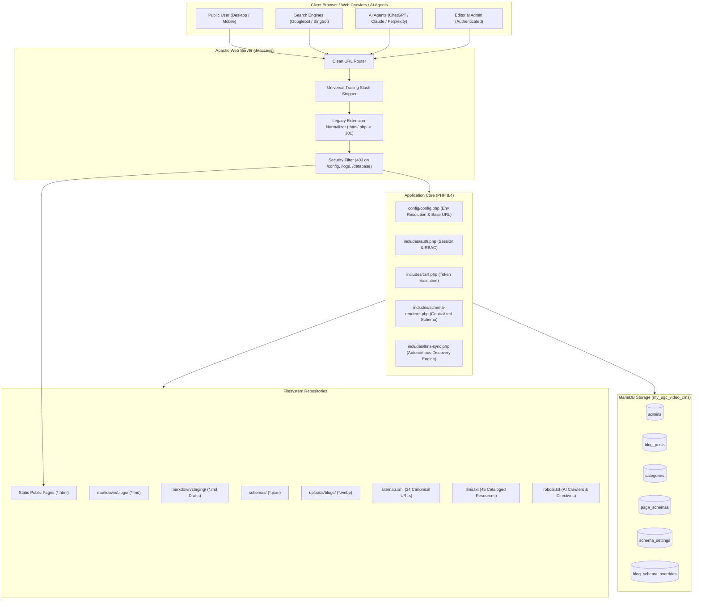
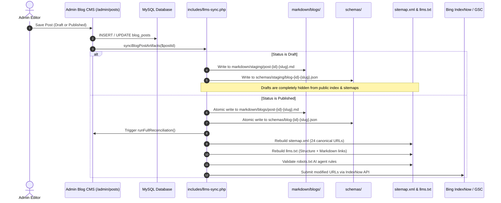

# SYSTEM ARCHITECTURE & AUTOMATION FLOW
**Project:** MY UGC VIDEO  
**Environment:** Apache / PHP 8.4 / MariaDB / XAMPP  
**Production Domain:** `https://myugcvideo.com`  
**Report Date:** 2026-11-06  

---

## 1. High-Level Architectural Overview

MY UGC VIDEO operates on a **hybrid static-dynamic architecture**:
- **Public Core Website:** Fast, resilient, framework-free HTML5, CSS3, and Vanilla JavaScript (`index.html`, `about.html`, `services.html`, `contact.html`, `404.html`, and 9 dedicated service detail pages in `services/*.html`).
- **Dynamic Editorial Blog Engine:** PHP 8+ database-driven CMS (`blogs.php` and `blog.php`) backed by MariaDB (`my_ugc_video_cms`).
- **Administrative Control Suite:** Clean, session-secured editorial administration panel at `/admin` (`dashboard`, `posts`, `categories`, `media`, `markdown`, `schema-manager`).
- **Autonomous SEO & LLM Discovery Pipeline:** Centralized reconciliation engine (`includes/llms-sync.php` & `database/sync_llms.php`) synchronizing Markdown documentation, JSON-LD schemas, XML sitemaps, `llms.txt`, `robots.txt`, and Bing IndexNow search notifications.

---

## 2. LLM.txt & Markdown Automation Data Flow

The automation pipeline coordinates the conversion of CMS database content into clean AI-digestible Markdown assets and search engine discovery files.

---

## 3. Automation Triggers & Execution Modes

| Trigger Type | Source File / Handler | Invocation Event | Behavior & Guarantee |
| :--- | :--- | :--- | :--- |
| **Blog Create Trigger** | `admin/posts/create.php` | Post submission (Draft or Published) | Generates Markdown & JSON-LD; if published, reconciles sitemap, `llms.txt`, and notifies search engines. |
| **Blog Edit Trigger** | `admin/posts/edit.php` | Post update | Updates Markdown & JSON-LD; handles slug changes by deleting obsolete files; regenerates `sitemap.xml` & `llms.txt`. |
| **Blog Delete Trigger** | `admin/posts/delete.php` | Post deletion | Executes `removeBlogPostArtifacts()`, deletes DB row, purges Markdown/schema, removes from sitemap/llms, and pings IndexNow. |
| **CLI Scheduled Trigger** | `database/sync_llms.php` | Cron / Windows Task Scheduler / Terminal | Full database-to-markdown audit, sitemap regeneration, `llms.txt` compilation, and search engine pinging (`--dry-run` supported). |
| **Manual Schema Sync** | `admin/schema-manager.php` | Admin Save & Publish | Validates JSON-LD, compiles `@graph`, updates `page_schemas`, and updates public HTML schema tags. |

---

## 4. Idempotency & Fault-Tolerance Guarantees

1. **File Locking (`flock`):** Concurrent executions of `runFullReconciliation()` acquire an exclusive lock file (`logs/llms_sync.lock`). Redundant concurrent calls yield cleanly without race conditions.
2. **Atomic Writes (`atomicWriteFile`):** All Markdown, JSON, XML, and text files are written to a temporary `.tmp` file and atomically renamed (`rename()`). If generation fails midway, existing public files remain intact.
3. **Draft Privacy Staging:** Non-published posts are written to `markdown/staging/` and `schemas/staging/` protected by `.htaccess`. They are never published to `sitemap.xml`, `llms.txt`, or public routes.
4. **Strict URL Normalization (`validatePublicSeoUrl`):** Rejects invalid paths (`/blogs/*.php`), internal controllers (`/blog.php`), demo domains, raw spaces, and unapproved extensions before compiling sitemaps.

