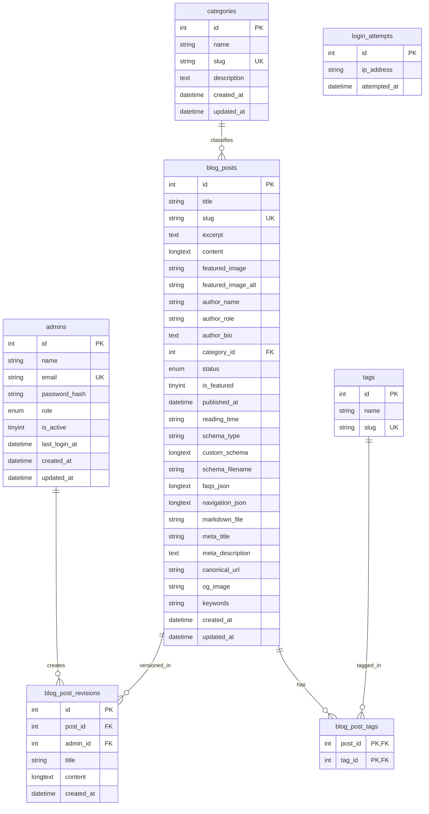
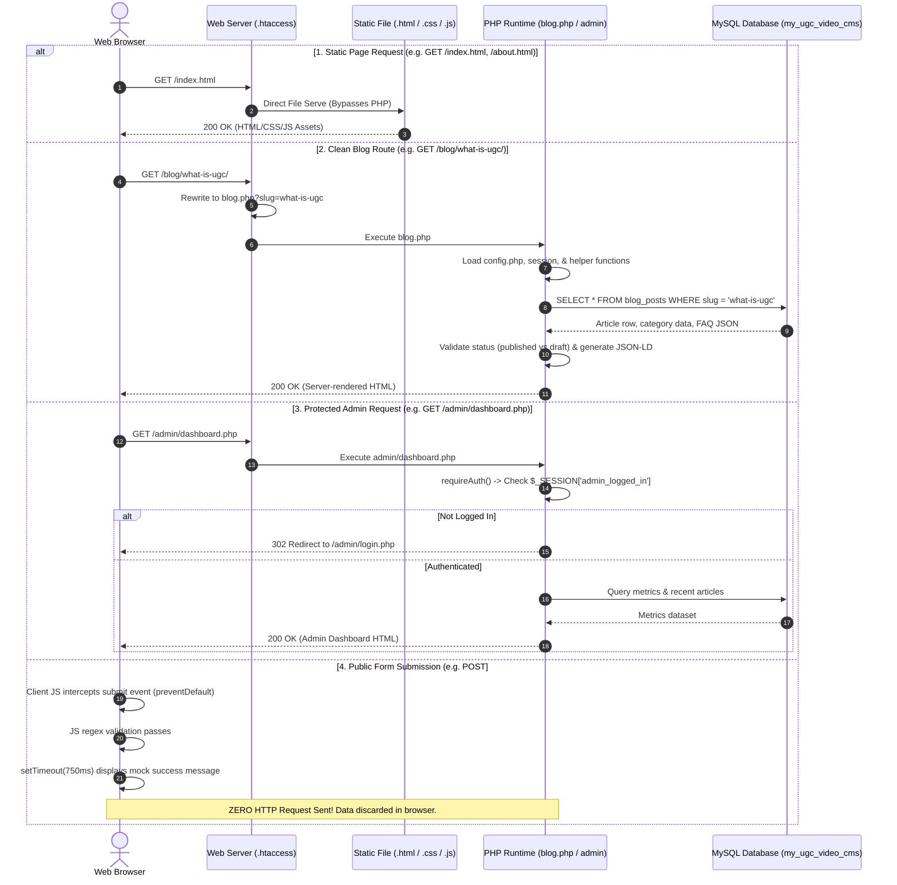

# MY UGC VIDEO — Comprehensive Frontend & Backend Technology Audit

**Document Version:** 1.0.0  
**Audit Date:** November 4, 2026  
**Audited Target:** `D:\ADITYA\UGC Website`  
**Auditor:** Senior Principal Full-Stack & Security Systems Auditor  
**Scope:** Complete Static Frontend, Dynamic PHP/MySQL Backend, Admin CMS, Database Architecture, Dependencies, Security Surface, and Performance/SEO Implementations.

---

## Table of Contents
1. [Executive Summary](#1-executive-summary)
2. [Frontend Technology Audit](#2-frontend-technology-audit)
3. [Backend Technology Audit](#3-backend-technology-audit)
4. [Database Architecture & Data Audit](#4-database-architecture--data-audit)
5. [Dependencies & Third-Party Services Audit](#5-dependencies--third-party-services-audit)
6. [Project Architecture & Request Flow](#6-project-architecture--request-flow)
7. [Security Audit & Vulnerability Assessment](#7-security-audit--vulnerability-assessment)
8. [Performance & Technical SEO Audit](#8-performance--technical-seo-audit)
9. [Final Technology Stack Summary Table](#9-final-technology-stack-summary-table)
10. [Prioritized Remediation & Recommendations](#10-prioritized-remediation--recommendations)

---

## 1. Executive Summary

A comprehensive source code, architecture, and security audit was conducted on the **MY UGC VIDEO** codebase (`D:\ADITYA\UGC Website`). The project is a hybrid web property comprising a **handcrafted static marketing site** integrated with an **in-house custom PHP 8 + MySQL Dynamic Editorial Content Management System (CMS)** and Markdown knowledge synchronization engine.

### Key Audit Findings at a Glance

| Domain | Status | Core Assessment |
| :--- | :--- | :--- |
| **Frontend Frameworks** | **Vanilla (Zero Framework)** | No React, Vue, Angular, Next.js, Bootstrap, or Tailwind. Handcrafted HTML5, modular Vanilla ES6+ JS, and an 11,686-line CSS3 design token system. |
| **Backend Engine** | **PHP 8.0+ (Custom MVC/CMS)** | Pure PHP 8.0+ procedural core with a PDO database singleton. No Laravel, Symfony, Node.js, Express, or Python runtime. |
| **Database** | **MySQL / MariaDB (InnoDB)** | Relational database (`my_ugc_video_cms`) with 7 normalized tables, foreign key constraints, revisions, and rate-limiting. |
| **Admin Panel** | **Fully Functional Custom CMS** | Custom dark editorial CMS located at `/admin/` with post CRUD, revisions, category management, media library, and bidirectional Markdown syncing. |
| **Contact & Inquiry Forms** | ⚠️ **Frontend Simulation Only** | **Critical business flaw:** All contact and project inquiry forms on `index.html` and `contact.html` execute simulated client-side timeouts (700–750ms). Inquiries are **never transmitted to any server endpoint or database**. |
| **Email Integration** | ❌ **Not Implemented** | No SMTP, PHPMailer, SendGrid, Mailgun, or native `mail()` configuration exists anywhere in the codebase. |
| **Video Playback** | ⚠️ **Mockup Poster Players** | No HTML5 `<video>` tags or streaming embeds (YouTube/Vimeo) exist. Video previews open a modal with a static `.jpg` poster. |
| **Security Surface** | ⚠️ **High / Critical Risks Found** | Maintenance/migration PHP endpoints in `database/` are unauthenticated; missing security headers; stored XSS risk in JSON-LD custom schema outputs; `.env` absent (defaults to debug mode). |
| **SEO Implementation** | ⚠️ **Partially Configured / Domain Mismatch** | Rich JSON-LD schemas and sitemaps are present, but canonical URLs and sitemaps hardcode `https://myugcvideo.example.com`, while `llms.txt` references `https://myugcvideo.com`. |

---

## 2. Frontend Technology Audit

### 2.1 HTML Version & Document Structure
- **HTML Specification:** Standard **HTML5** (`<!DOCTYPE html>`).
- **Semantic Structure:** Fully structured using semantic HTML5 elements: `<header role="banner">`, `<nav aria-label="...">`, `<main id="main-content">`, `<section aria-labelledby="...">`, `<article>`, `<aside>`, `<figure>`, `<figcaption>`, and `<footer role="contentinfo">`.
- **Primary Page Breakdown:**
  - `index.html` (1,505 lines) — Main commercial agency landing page with hero stage, interactive deliverables grid, video mock modal, case studies, service cards, FAQ accordion, inquiry form, and footer.
  - `about.html` (611 lines) — Studio ethos, creative production timeline, core pillars, and leadership.
  - `services.html` (2,904 lines) — Master services directory, deliverables matrix, interactive pricing/scope tiering, and comparison tables.
  - `contact.html` (596 lines) — Dual inquiry forms (Quick Consultation and Detailed Production Brief) plus WhatsApp quick action.
  - `404.html` (195 lines) — Custom branded error landing page with quick search and recovery links.
  - `services/*.html` (9 dedicated landing pages, ~830 lines each) — High-intent search landing pages for niche UGC services.
  - `blogs.html` (597 lines) — Static legacy blog listing.
  - `blogs/*.html` (10 files, ~460 lines each) — Static legacy blog articles (mirrored dynamically in `blog.php`).

### 2.2 CSS Version & Styling Approach
- **CSS Specification:** **CSS3**.
- **File Location:** [`css/style.css`](file:///d:/ADITYA/UGC%20Website/css/style.css) (11,686 lines) and [`admin/assets/admin.css`](file:///d:/ADITYA/UGC%20Website/admin/assets/admin.css) (1,630 lines).
- **Architecture & Methodology:**
  - **CSS Custom Properties (Variables):** Extensive design token system defined in `:root` ([`css/style.css` lines 9–105](file:///d:/ADITYA/UGC%20Website/css/style.css#L9-L105)). Colors follow a 6-color dark editorial palette:
    - Main Background: Almost Black Teal (`#001713`)
    - Surface / Alternate: Deep Forest Green (`#00221E`)
    - Brand Accents: Emerald Teal (`#00BFA5`)
    - Primary Action / CTAs: Mint Green (`#36D9B0`)
    - Text & Headings: Soft Off White (`#D9E5DF`)
    - Borders & Dividers: Muted Sage Green (`#31534D`)
  - **Layout Engines:** Strict native **CSS Grid** (`grid-template-columns: repeat(...)`) and **Flexbox**; zero float-based or table-based layout hacks.
  - **Fluid Sizing:** Broad use of modern `clamp()` functions for responsive typography and fluid padding (e.g. `font-size: clamp(2rem, 5vw, 3.5rem)`).
  - **Visual Effects:** CSS Glassmorphism with `backdrop-filter: blur(12px)` and `-webkit-backdrop-filter` fallbacks.
- **CSS Frameworks:**
  - **Bootstrap:** **Not found** (0 references).
  - **Tailwind CSS:** **Not found** (No utility build steps or `@tailwind` directives).
  - **Bulma / Foundation:** **Not found**.
  - **Status:** **100% Handcrafted Vanilla CSS**.

### 2.3 JavaScript Version & Architecture
- **JavaScript Specification:** **ECMAScript 2020+ (ES6+)**.
- **File Location:** [`js/main.js`](file:///d:/ADITYA/UGC%20Website/js/main.js) (1,222 lines).
- **Framework Assessment:**
  - **React:** **Not found**.
  - **Vue.js:** **Not found**.
  - **Angular:** **Not found**.
  - **Next.js / Nuxt / Vite / Webpack:** **Not found**.
  - **Status:** **Pure Vanilla JavaScript (Zero External Runtime Libraries)**.
- **Code Architecture:**
  - Event-driven initialization on `DOMContentLoaded` ([`js/main.js` lines 8–25](file:///d:/ADITYA/UGC%20Website/js/main.js#L8-L25)).
  - Modular function namespaces:
    - `initStickyHeader()` (Lines 30–44) — Passive scroll listener toggling `.scrolled` state.
    - `initMobileNav()` (Lines 49–95) — Drawer state controller with backdrop lock and Escape-key listener.
    - `initMobileDropdown()` (Lines 100–120) — Mobile navigation accordion drawer toggle.
    - `initFaqAccordion()` (Lines 125–204) — Single-open accessible accordion with smooth height calculations.
    - `initBlogFilters()` (Lines 206–382) — Real-time DOM category filtering, live text search, and pagination slicing.
    - `initContactForm()` (Lines 384–510) — Regex-based input validation and simulated submit.
    - `initNewsletterForms()` (Lines 515–548) — Client-side email validation and feedback.
    - `setActiveNavLinks()` (Lines 550–573) — Dynamic URL pathname matching for active link indicators.
    - `initInteractiveServicesDirectory()` (Lines 575–630) — Interactive service card hover previews.
    - `initServicesSlider()` (Lines 632–810) — Custom touch/drag/button horizontal carousels.
    - `initDualInquiryForms()` (Lines 812–887) — Project brief form validation on `contact.html`.
    - `initUgcCategoryTabs()` (Lines 902–930) — Tabbed category switcher.
    - `initVideoModal()` (Lines 932–976) — Video showcase popup dialog.
    - `initHomepagePortfolioFilter()` (Lines 981–1019) — Asymmetric work filter.
    - `initHomepageInquiryForm()` (Lines 1112–1222) — Multistep project inquiry simulation.

### 2.4 Animation Libraries
- **GSAP (GreenSock):** **Not found**.
- **AOS (Animate on Scroll):** **Not found**.
- **Lenis Scroll:** **Not found**.
- **Framer Motion:** **Not found**.
- **Implementation:** All transitions, hover scaling (`transform: translateY(-4px)`), fade-ins, and pulsing glowing borders are implemented via native **CSS3 `@keyframes` and transitions** in `css/style.css` (e.g. `@keyframes pulseGlow`, `@keyframes modalFadeIn`).

### 2.5 Icon Libraries & Implementation
- **FontAwesome / Lucide / Feather / Material Icons:** **Not found via CDN or icon font**.
- **Implementation:** 100% **Inline SVG Vectors**.
  - All icons (chevrons, play buttons, social media logos, validation checkmarks, alert symbols) are embedded directly as `<svg>` elements with `stroke="currentColor"` or `fill="currentColor"`.
  - Zero external HTTP requests or render-blocking icon webfonts.

### 2.6 Typography & Font Loading
- **Typefaces:**
  1. **Manrope** (Weights: 400, 500, 600, 700, 800) — Primary UI and body copy font.
  2. **Sora** (Weights: 600, 700, 800) — Editorial headlines, display titles, and branding.
  3. **JetBrains Mono** (Weights: 400, 500) — Code snippets, tags, and admin CMS metadata.
- **Loading Mechanism:**
  - External CDN: **Google Fonts** (`fonts.googleapis.com` & `fonts.gstatic.com`).
  - Preconnect Optimization: `<link rel="preconnect" href="https://fonts.googleapis.com">` and `<link rel="preconnect" href="https://fonts.gstatic.com" crossorigin>` included in all `<head>` sections.
  - FOIT Strategy: `display=swap` included in font query strings.
  - Self-hosted Font Files (`.woff2`, `.woff`, `.ttf`): **Not found** in project directory.

### 2.7 Video and Image Implementation
- **Video Implementation:**
  - ❌ **No Video Files Exist:** No `.mp4`, `.webm`, or `.mov` video assets exist anywhere in the repository.
  - ❌ **No `<video>` Elements:** No HTML5 `<video>` tags are used across the entire codebase.
  - ⚠️ **Mock Video Modal:** The "Video Preview Player" ([`index.html` lines 1411–1430](file:///d:/ADITYA/UGC%20Website/index.html#L1411-L1430)) actually populates a standard `` element (`#videoModalImg`) with a static JPG poster ([`js/main.js` lines 943–946](file:///d:/ADITYA/UGC%20Website/js/main.js#L943-L946)). No streaming player (HLS, DASH, Vimeo, YouTube) is integrated.
- **Image Implementation:**
  - **Asset Pool:** 43 static `.jpg` images in `images/` across `hero/`, `about/`, `portfolio/`, `services/`, and `blogs/`. Dynamic WebP/JPG images in `uploads/blogs/`.
  - **Lazy Loading:** `loading="lazy"` is systematically implemented on below-the-fold images across all pages.
  - **LCP Optimization:** Hero images have explicit `loading="eager"` and `fetchpriority="high"` (e.g. [`index.html` line 283](file:///d:/ADITYA/UGC%20Website/index.html#L283)).
  - **Layout Shift (CLS) Prevention:** Explicit `width` and `height` dimensions are declared on image tags.
  - ⚠️ **Missing Next-Gen Picture Tags:** No `<picture>` elements or `srcset` attributes are utilized for responsive resolution switching or AVIF/WebP fallback delivery in static templates.

### 2.8 Responsive Design & Breakpoints
The layout utilizes a fluid, desktop-down approach reinforced with extensive media queries in [`css/style.css`](file:///d:/ADITYA/UGC%20Website/css/style.css):
- **Viewport Breakpoints Identified:**
  - `1200px` — Container constraints and multi-column grid adjustments.
  - `1100px` / `1024px` — Hero stage realignment and card re-flow.
  - `992px` / `991px` / `900px` — Two-column table and services collapse.
  - `768px` — **Primary Mobile Breakpoint**: Desktop navbar hides; hamburger drawer activates; grid switches to single-column; form inputs expand full-width.
  - `700px` / `680px` / `640px` / `600px` — Asymmetric portfolio and card padding adjustments.
  - `480px` — Small screen adjustments for modal padding, action buttons, and breadcrumbs.
  - `360px` — Ultra-compact phone adjustments preventing horizontal overflow.
- **Hardware & Accessibility Features:**
  - `@media (hover: hover)` ([`css/style.css` line 5214](file:///d:/ADITYA/UGC%20Website/css/style.css#L5214)) — Suppresses hover-state glitching on touchscreen devices.
  - `@media (prefers-reduced-motion: reduce)` ([`css/style.css` lines 3978, 6916, 9053, 9315](file:///d:/ADITYA/UGC%20Website/css/style.css#L3978)) — Enforces instantaneous transitions and suppresses CSS keyframe loops for users with vestibular sensitivities.
  - `@media (scripting: none)` ([`css/style.css` line 3968](file:///d:/ADITYA/UGC%20Website/css/style.css#L3968)) — Progressive enhancement providing fallback styling if JavaScript is disabled.

### 2.9 Navigation & Dropdown Implementation
- **Desktop Navigation:**
  - Fixed-position sticky navigation header ([`css/style.css` lines 112–195](file:///d:/ADITYA/UGC%20Website/css/style.css#L112-L195)).
  - Services Mega-Dropdown: Triggered via CSS `:hover` and `:focus-within` with smooth opacity and pointer-event transitions ([`css/style.css` lines 230–310](file:///d:/ADITYA/UGC%20Website/css/style.css#L230-L310)).
- **Mobile Drawer Navigation:**
  - Off-canvas drawer sliding from the right (`.mobile-drawer`).
  - Darkened backdrop overlay (`.drawer-overlay`).
  - Synchronized ARIA attributes (`aria-expanded="true/false"`).
  - Background body scroll locking (`document.body.style.overflow = 'hidden'`).
  - Accessible keyboard navigation: Escape key immediately dismisses drawer and restores focus.

### 2.10 Forms and Client-Side Validation
Four distinct forms exist across the website:
1. **Quick Contact Form** (`#contactForm` on `contact.html:306`).
2. **Detailed Project Scope Form** (`#detailedInquiryForm` on `contact.html:387`).
3. **Homepage Multi-Service Inquiry Form** (`#projectInquiryForm` on `index.html:1329`).
4. **Newsletter Subscription Form** (`.newsletter-form` on all footers).

**Validation Behavior:**
- Form inputs disable default browser tooltips via `novalidate`.
- Custom JavaScript handlers test values against regex patterns:
  - Email: `/^[^\s@]+@[^\s@]+\.[^\s@]+$/`
  - Name: Minimum 2 characters.
  - Scope/Brief: Minimum 15 characters.
- Error indicators apply `.error` classes with inline error message nodes (`.form-error-msg`).
- ⚠️ **Critical Operational Finding:** Upon successful validation, **none of these forms submit data to a server**. They trigger `setTimeout(() => { form.reset(); showSuccess(); }, 750)` to display a mock confirmation message ([`js/main.js` lines 488–499, 874–885, 1209–1220](file:///d:/ADITYA/UGC%20Website/js/main.js#L488-L499)).

### 2.11 Accessibility (a11y) Implementation
- **WCAG Strengths:**
  - High contrast color choices: Soft Off White (`#D9E5DF`) against Deep Forest Green (`#001713`) yields a **15.1:1 contrast ratio**, exceeding WCAG AAA standards. Mint Green (`#36D9B0`) on dark backgrounds yields **9.6:1** (WCAG AAA compliant).
  - Interactive ARIA attributes: `aria-expanded`, `aria-label`, `aria-modal="true"`, `aria-live="polite"`, `role="dialog"`.
  - Full keyboard dismissal: All modals and drawers bind to the `Escape` key.
  - Native reduced motion support: `@media (prefers-reduced-motion: reduce)`.
- **WCAG Shortcomings:**
  - ❌ **No Skip Link:** No "Skip to main content" link exists at the top of any page.
  - ❌ Focus traps are not implemented in the mobile drawer or video modal (tab navigation can cycle behind the modal).

---

## 3. Backend Technology Audit

### 3.1 Runtime Environment & Version Requirements
- **Primary Language:** **PHP**.
- **Minimum Version Requirement:** **PHP 8.0+** (Evidence: widespread usage of PHP 8.0 features including `str_starts_with()`, `str_contains()`, `str_ends_with()` in [`config/config.php` lines 19, 20, 68](file:///d:/ADITYA/UGC%20Website/config/config.php#L19), typed class properties with nullability `private static ?PDO $instance = null` in [`config/database.php` line 14](file:///d:/ADITYA/UGC%20Website/config/database.php#L14), and union return types).
- **Node.js / Express / Python / Ruby / Go:** **Not found** (Zero backend runtime scripts or package manifests).

### 3.2 Database Engine & Connection Implementation
- **Database Driver:** PHP **PDO (PHP Data Objects)** with the `mysql` driver.
- **Connection Architecture:** Implemented as a Singleton in [`config/database.php` lines 13–46](file:///d:/ADITYA/UGC%20Website/config/database.php#L13-L46) (`Database::getConnection()`).
- **Connection Flags & Attributes:**
  - Character set: `utf8mb4` with `utf8mb4_unicode_ci` collation.
  - Error Mode: `PDO::ATTR_ERRMODE => PDO::ERRMODE_EXCEPTION`.
  - Fetch Mode: `PDO::ATTR_DEFAULT_FETCH_MODE => PDO::FETCH_ASSOC`.
  - Prepared Statement Emulation: `PDO::ATTR_EMULATE_PREPARES => false` (crucial defense preventing SQL injection).
- **Environment Configuration:**
  - Reads connection parameters from `.env` via `getenv()` with fallback defaults:
    - Host: `127.0.0.1` | Port: `3306`
    - Database Name: `my_ugc_video_cms`
    - User: `root` | Password: (empty)

### 3.3 Dynamic Blog Engine (`blog.php` & `blogs.php`)
- **Public Dynamic Blog Listing ([`blogs.php`](file:///d:/ADITYA/UGC%20Website/blogs.php)):**
  - Replaces static `blogs.html`.
  - Queries `blog_posts` for the featured article (`is_featured = 1`) and lists up to 50 published non-featured articles ([`blogs.php` lines 13–24](file:///d:/ADITYA/UGC%20Website/blogs.php#L13-L24)).
  - Dynamically renders category badges, publication dates, reading time estimates, and author cards.
- **Public Dynamic Blog Detail ([`blog.php`](file:///d:/ADITYA/UGC%20Website/blog.php)):**
  - Resolves article by `slug` parameter (`blog.php?slug=...` or `/blog/slug/` via `.htaccess`).
  - Enforces draft privacy: draft articles return HTTP 404 unless an authenticated administrator session is active ([`blog.php` lines 19–38](file:///d:/ADITYA/UGC%20Website/blog.php#L19-L38)).
  - Queries up to 3 contextual related articles in the same category ([`blog.php` line 41](file:///d:/ADITYA/UGC%20Website/blog.php#L41)).
  - Dynamically generates structured data (Schema.org JSON-LD `BlogPosting` or custom schema).

### 3.4 Admin Panel / CMS Architecture
Located in `/admin/`, the CMS is a custom editorial platform built for content creators and agency editors:
1. **Gateway & Dashboard:**
   - [`admin/index.php`](file:///d:/ADITYA/UGC%20Website/admin/index.php) — Session gateway routing to login or dashboard.
   - [`admin/dashboard.php`](file:///d:/ADITYA/UGC%20Website/admin/dashboard.php) — Metric overview reporting total articles, published count, drafts, categories, and recent article list.
2. **Article CRUD Operations:**
   - [`admin/posts/index.php`](file:///d:/ADITYA/UGC%20Website/admin/posts/index.php) — Article inventory table with real-time status filters (Published/Draft), category filters, live search, quick status toggling, and featured toggling.
   - [`admin/posts/create.php`](file:///d:/ADITYA/UGC%20Website/admin/posts/create.php) (2,190 lines) — Rich post authoring suite featuring toggleable desktop/mobile preview, auto-slugification, featured image uploader, schema generator/uploader, and FAQ builder.
   - [`admin/posts/edit.php`](file:///d:/ADITYA/UGC%20Website/admin/posts/edit.php) (2,259 lines) — Post editor with automated snapshot archiving to `blog_post_revisions` ([`admin/posts/edit.php` lines 154–165](file:///d:/ADITYA/UGC%20Website/admin/posts/edit.php#L154-L165)).
   - [`admin/posts/delete.php`](file:///d:/ADITYA/UGC%20Website/admin/posts/delete.php) — Parameterized deletion handler protected by CSRF verification.
3. **Category Management:**
   - [`admin/categories/index.php`](file:///d:/ADITYA/UGC%20Website/admin/categories/index.php) — Add and remove categories with auto-slugification and article count aggregation.
4. **Media Library:**
   - [`admin/media/index.php`](file:///d:/ADITYA/UGC%20Website/admin/media/index.php) — File manager scanning `uploads/blogs/` and `images/blogs/`, featuring image preview grids, copyable URL chips, and file upload handlers.
5. **Markdown & LLM Directive Center:**
   - [`admin/markdown/index.php`](file:///d:/ADITYA/UGC%20Website/admin/markdown/index.php) — Management console for public AI directives (`llms.txt`), blog markdown synchronization, and documentation files.
6. **First-Run Setup:**
   - [`admin/setup.php`](file:///d:/ADITYA/UGC%20Website/admin/setup.php) — Initial administrator registration wizard. Permanently locks itself (HTTP 403) as soon as 1 administrator record exists in `admins` ([`admin/setup.php` lines 13–36](file:///d:/ADITYA/UGC%20Website/admin/setup.php#L13-L36)).

### 3.5 Authentication & Session Security
- **Authentication Controller:** [`includes/auth.php`](file:///d:/ADITYA/UGC%20Website/includes/auth.php).
- **Password Storage:** Uses PHP native `password_hash($password, PASSWORD_DEFAULT)` generating strong Bcrypt hashes. Verified via `password_verify()`.
- **Session Protection:**
  - Initialized in [`config/config.php` lines 89–100](file:///d:/ADITYA/UGC%20Website/config/config.php#L89-L100).
  - Flags configured: `httponly = true`, `samesite = 'Lax'`, `secure = true` (auto-detected on HTTPS), `lifetime = 0`.
  - Fixation defense: `session_regenerate_id(true)` is executed upon successful login ([`includes/auth.php` line 60](file:///d:/ADITYA/UGC%20Website/includes/auth.php#L60)).
- **Brute-Force Rate Limiting:**
  - IP-based tracking using table `login_attempts`.
  - Enforces a ceiling of **5 failed login attempts per 15 minutes** ([`includes/auth.php` lines 35–45](file:///d:/ADITYA/UGC%20Website/includes/auth.php#L35-L45)). Cleared on successful login.

### 3.6 File Upload System & Storage
- **Image Upload Handler:** [`includes/functions.php` lines 267–323](file:///d:/ADITYA/UGC%20Website/includes/functions.php#L267-L323) (`handleImageUpload()`).
  - MIME Verification: Server-side `finfo(FILEINFO_MIME_TYPE)` inspection.
  - Whitelist: `image/jpeg`, `image/png`, `image/webp`, `image/gif`.
  - Extension Mapping: Extension derived strictly from verified MIME type, not client filename.
  - Randomized Naming: `blog_YYYYMMDD_HHMMSS_<hex>.<ext>`.
  - Permissions: Stored files chmodded to `0644`.
  - Direct Execution Lockdown: [`uploads/blogs/.htaccess`](file:///d:/ADITYA/UGC%20Website/uploads/blogs/.htaccess) disables PHP execution engine (`php_flag engine off`) and forbids script execution (`Deny from all`).
- **Schema Upload Handler:** [`includes/functions.php` lines 580–635](file:///d:/ADITYA/UGC%20Website/includes/functions.php#L580-L635) (`validateUploadedSchemaFile()`).
  - Size capped at 500 KB; validated for JSON-LD syntax; stored in `uploads/schemas/` with execution lockdown in [`uploads/schemas/.htaccess`](file:///d:/ADITYA/UGC%20Website/uploads/schemas/.htaccess).

### 3.7 Markdown Engine & AI Directive Router
- **Markdown Conversion Engine:** [`includes/functions.php` lines 643–860](file:///d:/ADITYA/UGC%20Website/includes/functions.php#L643-L860) (`markdownToHtml()`).
  - Pure PHP regex-based parser supporting headings, lists, blockquotes, code blocks, bold/italic formatting, and full Markdown tables.
- **Bidirectional Syncing:** [`includes/functions.php` lines 945–1035](file:///d:/ADITYA/UGC%20Website/includes/functions.php#L945-L1035) (`syncBlogPostToMarkdown()`).
  - Converts published blog posts into structured Markdown files with YAML frontmatter in `markdown/blogs/`.
- **Public Markdown Router:** [`markdown/view.php`](file:///d:/ADITYA/UGC%20Website/markdown/view.php).
  - Traversal defense: Validates target against `realpath(MARKDOWN_DIR)` or root `llms.txt`.
  - Draft privacy: Restricts access to draft article markdown files to authenticated admins.

---

## 4. Database Architecture & Data Audit

### 4.1 Database Specification
- **Engine:** MySQL 5.7+ / 8.0+ or MariaDB 10.3+.
- **Database Name:** `my_ugc_video_cms`.
- **Default Storage Engine:** `InnoDB`.
- **Character Set & Collation:** `utf8mb4` / `utf8mb4_unicode_ci`.
- **DDL Definition File:** [`database/schema.sql`](file:///d:/ADITYA/UGC%20Website/database/schema.sql).

### 4.2 Entity Relationship Model



### 4.3 Table Catalog & Schema Purposes

| Table Name | Engine | Columns | Primary Key | Foreign Keys | Indexing | Purpose |
| :--- | :--- | :--- | :--- | :--- | :--- | :--- |
| `admins` | InnoDB | 9 | `id` | None | `email` (UNIQUE) | Administrator credentials, access roles, and last login telemetry. |
| `categories` | InnoDB | 6 | `id` | None | `slug` (UNIQUE) | Editorial blog categorization taxonomy. |
| `tags` | InnoDB | 3 | `id` | None | `slug` (UNIQUE) | Taxonomy tags (defined in schema, currently unused in UI forms). |
| `blog_posts` | InnoDB | 28 | `id` | `category_id` -> `categories(id)` ON DELETE SET NULL | `slug` (UNIQUE), `idx_status_published` (`status`, `published_at`), `idx_category` (`category_id`) | Central blog article repository, author data, SEO metadata, JSON-LD schemas, and FAQ data. |
| `blog_post_tags` | InnoDB | 2 | (`post_id`, `tag_id`) | `post_id` -> `blog_posts(id)` ON DELETE CASCADE, `tag_id` -> `tags(id)` ON DELETE CASCADE | Composite PK | Many-to-many relationship mapping between posts and tags. |
| `blog_post_revisions` | InnoDB | 6 | `id` | `post_id` -> `blog_posts(id)` ON DELETE CASCADE, `admin_id` -> `admins(id)` ON DELETE SET NULL | None | Historical snapshots of post titles and content created upon every update. |
| `login_attempts` | InnoDB | 3 | `id` | None | `idx_ip_attempted` (`ip_address`, `attempted_at`) | IP-based rate limiting records to thwart brute-force login attacks. |

### 4.4 Ingestion & Migration Scripts
- [`database/migrate_existing_blogs.php`](file:///d:/ADITYA/UGC%20Website/database/migrate_existing_blogs.php) (314 lines): Automated HTML-to-MySQL ETL script. Parses legacy static HTML files in `blogs/`, extracts metadata and article bodies via DOM/regex, automatically generates categories, and inserts records into `blog_posts`.
- [`database/migrate_enhancements.php`](file:///d:/ADITYA/UGC%20Website/database/migrate_enhancements.php) (35 lines): Schema migration script adding `schema_type`, `custom_schema`, `faqs_json`, and `markdown_file` columns.
- [`database/update_sitemap.php`](file:///d:/ADITYA/UGC%20Website/database/update_sitemap.php) (80 lines): CLI/web utility synchronizing `sitemap.xml` with published articles from MySQL.

### 4.5 Database Backup Implementation
- **Static File Backup:** Legacy HTML files are backed up in `database/backups/blogs_static_backup/` (10 HTML files).
- ❌ **SQL Automated Backups:** **Not implemented**. There are no automated `mysqldump` scripts, cron tasks, or scheduled database dump utilities in the project.

---

## 5. Dependencies & Third-Party Services Audit

### 5.1 Package Manifests & Package Managers
- `package.json` / `package-lock.json`: **Not found** (No Node.js packages).
- `composer.json` / `composer.lock`: **Not found** (No PHP Composer packages).
- `yarn.lock` / `pnpm-lock.yaml`: **Not found**.
- **Assessment:** The application runs **100% dependency-free** without external package managers.

### 5.2 Third-Party Services & Dependencies Catalog

| Dependency / Service | Category | Integration Method | Where It Is Used | Actual Usage Status | Evidence / Notes |
| :--- | :--- | :--- | :--- | :--- | :--- |
| **Google Fonts CDN** | Web Fonts | `<link rel="stylesheet">` | `<head>` of all HTML & PHP pages | **Actively Used** | Delivers `Manrope`, `Sora`, and `JetBrains Mono`. Preconnects used. |
| **WhatsApp Direct Link** | Communications | HTML `wa.me` anchor link | [`contact.html` lines 231, 490](file:///d:/ADITYA/UGC%20Website/contact.html#L231) | **Configured but Placeholder** | Points to dummy placeholder number `+91 98765 43210`. No WhatsApp API or webhook. |
| **Apache mod_rewrite** | Web Server Engine | `.htaccess` | [`.htaccess` lines 5–25](file:///d:/ADITYA/UGC%20Website/.htaccess#L5-L25) | **Actively Used (if on Apache)** | Routes `/blog/slug/`, protects `.env` and `logs/`. |
| **PHP finfo** | Server Extension | Native PHP function | [`includes/functions.php` line 290](file:///d:/ADITYA/UGC%20Website/includes/functions.php#L290) | **Actively Used** | Server-side MIME type detection for uploaded media. |
| **Google Analytics / GTM** | Analytics | N/A | Entire codebase | ❌ **Not Found** | No GA4, GTM, or gtag scripts exist. |
| **Meta Pixel / TikTok Pixel**| Ad Tracking | N/A | Entire codebase | ❌ **Not Found** | No ad tracking pixels configured. |
| **CAPTCHA (reCAPTCHA / Turnstile)**| Bot Protection | N/A | Entire codebase | ❌ **Not Found** | Relies solely on database IP rate-limiting. |
| **Email Service (SMTP / API)**| Email Delivery | N/A | Entire codebase | ❌ **Not Found** | No mail transport service is configured. |
| **Google Maps Embed** | Mapping | N/A | `contact.html` | ❌ **Not Found** | Address listed as text ("Delhi, NCR, India") without embed. |
| **Video Streaming Hosting** | Media Hosting | N/A | `index.html` | ❌ **Not Found** | No Vimeo, YouTube, Wistia, or Cloudflare Stream embeds. |

---

## 6. Project Architecture & Request Flow

### 6.1 Directory Map & Structural Organization

```
D:\ADITYA\UGC Website\
│
├── .env.example              # Environment configuration template
├── .gitignore                # Git ignore directives
├── .htaccess                 # Apache rewrite engine and security rules
├── 404.html                  # Branded 404 error page
├── about.html                # Static About Us page
├── blog.php                  # Dynamic Individual Blog Detail controller & template
├── blogs.html                # Static legacy blog index
├── blogs.php                 # Dynamic Blog Listing controller & template
├── contact.html              # Static Contact & Inquiry page
├── index.html                # Main static homepage
├── llms.txt                  # Public AI/LLM directive and studio summary
├── README.md                 # Project overview documentation
├── README-XAMPP.md           # Local deployment and setup guide
├── robots.txt                # Search engine crawler directives
├── services.html             # Master Services Directory page
├── sitemap.xml               # XML Sitemap (152 indexed URLs)
│
├── admin/                    # Custom Editorial CMS
│   ├── index.php             # Admin route router
│   ├── login.php             # Admin authentication page
│   ├── logout.php            # Session termination handler
│   ├── setup.php             # First-run admin initialization wizard
│   ├── dashboard.php         # Metric overview and recent articles
│   ├── assets/
│   │   └── admin.css         # Dark editorial CMS stylesheet (1,630 lines)
│   ├── categories/
│   │   └── index.php         # Category CRUD controller
│   ├── includes/
│   │   ├── header.php        # Admin sidebar layout and head markup
│   │   └── footer.php        # Admin drawer script and footer markup
│   ├── markdown/
│   │   └── index.php         # Markdown manager and llms.txt editor
│   ├── media/
│   │   └── index.php         # Image asset gallery and uploader
│   └── posts/
│       ├── index.php         # Blog article inventory table
│       ├── create.php        # Article creation suite with live preview
│       ├── edit.php          # Article editor with revision snapshots
│       └── delete.php        # Article deletion handler
│
├── blogs/                    # Static legacy blog articles (10 files)
│   ├── what-is-ugc.html
│   └── ...
│
├── config/                   # System Configuration
│   ├── config.php            # Environment, base URL, session, and constants
│   └── database.php          # PDO database connection singleton
│
├── css/
│   └── style.css             # Master frontend design system (11,686 lines)
│
├── database/                 # Database Schema & Migrations
│   ├── schema.sql            # Master DDL database schema
│   ├── migrate_existing_blogs.php # Static HTML-to-MySQL parser
│   ├── migrate_enhancements.php   # Column additions patch
│   ├── update_sitemap.php    # Sitemap dynamic synchronizer
│   └── backups/
│       └── blogs_static_backup/   # 10 static backup HTML files
│
├── images/                   # Static Visual Media Assets (43 JPGs)
│   ├── about/
│   ├── blogs/
│   ├── hero/
│   ├── portfolio/
│   └── services/
│
├── includes/                 # Shared PHP Business Logic
│   ├── auth.php              # Auth middleware, rate-limiting, and sessions
│   ├── csrf.php              # Anti-CSRF token generator and validator
│   ├── functions.php         # Global helpers, Markdown parser, schemas (1,060 lines)
│   ├── blog-header.php       # Public dynamic blog header partial
│   └── blog-footer.php       # Public dynamic blog footer partial
│
├── js/
│   └── main.js               # Master frontend JavaScript interactions (1,222 lines)
│
├── logs/
│   └── php_errors.log        # PHP server error log
│
├── markdown/                 # Markdown Storage & Knowledge Base
│   ├── view.php              # Secure public Markdown / LLM file viewer
│   ├── blogs/                # 10 synchronized blog markdown files
│   ├── case-studies/         # Directory for case study markdown
│   ├── pages/                # Directory for static page markdown
│   └── other/                # Miscellaneous markdown documents
│
├── services/                 # Dedicated High-Intent Niche Service Pages (9 files)
│   ├── ai-ugc-videos-company.html
│   ├── ugc-product-reviews-videos-company.html
│   ├── ugc-product-videos-company.html
│   ├── ugc-testimonial-videos-company.html
│   ├── ugc-unboxing-videos-company.html
│   ├── ugc-video-ads-company.html
│   ├── ugc-video-creation-company.html
│   ├── ugc-video-editing-service-company.html
│   └── ugc-video-service-in-delhi-company.html
│
└── uploads/                  # Dynamic Uploaded Assets
    ├── blogs/                # User-uploaded post featured images (.htaccess protected)
    └── schemas/              # Custom JSON-LD schema uploads (.htaccess protected)
```

### 6.2 End-to-End Request Flow Architecture



---

## 7. Security Audit & Vulnerability Assessment

Security findings are classified according to severity: **Critical**, **High**, **Medium**, and **Low**.

### 7.1 Critical Severity Findings

#### Finding SEC-01: Publicly Accessible, Unauthenticated Database Migration & Maintenance Scripts
- **Severity:** 🔴 **CRITICAL**
- **Affected Files:**
  - [`database/migrate_existing_blogs.php`](file:///d:/ADITYA\UGC%20Website\database\migrate_existing_blogs.php#L13-L26)
  - [`database/migrate_enhancements.php`](file:///d:/ADITYA\UGC%20Website\database\migrate_enhancements.php#L1-L35)
  - [`database/update_sitemap.php`](file:///d:/ADITYA\UGC%20Website\database\update_sitemap.php#L1-L80)
- **Vulnerability Mechanism:**
  - `.htaccess` rule on line 9 specifically blocks only `database/schema\.sql`:
    ```apache
    RewriteRule ^(\.env|\.git|database/schema\.sql|logs/) - [F,L,NC]
    ```
  - The rest of the `database/` folder is **not blocked**.
  - None of these three scripts invoke `requireAuth()` or inspect `isLoggedIn()`.
  - Visiting `http://example.com/database/migrate_existing_blogs.php` or `migrate_enhancements.php` directly triggers database ALTER/INSERT/UPDATE queries from anyone on the internet, allowing unauthorized modification or disruption of production data.

#### Finding SEC-02: Total Silent Failure / Data Loss in Public Forms (Business Logic Critical)
- **Severity:** 🔴 **CRITICAL (Business Integrity)**
- **Affected Files:**
  - [`index.html` lines 1329–1405](file:///d:/ADITYA/UGC%20Website/index.html#L1329-L1405)
  - [`contact.html` lines 306–465](file:///d:/ADITYA/UGC%20Website/contact.html#L306-L465)
  - [`js/main.js` lines 482–500, 869–886, 1202–1221](file:///d:/ADITYA/UGC%20Website/js/main.js#L482-L500)
- **Vulnerability Mechanism:**
  - Commercial leads entering project specifications, phone numbers, and budgets are never transmitted to a backend script, database table, or email service.
  - The submit event is intercepted by JavaScript `e.preventDefault()`, which triggers a mock `setTimeout()` and displays "Inquiry Received" while discarding the data.

---

### 7.2 High Severity Findings

#### Finding SEC-03: Potential Stored XSS via JSON-LD Structured Data Output
- **Severity:** 🟠 **HIGH**
- **Affected Files:**
  - [`includes/functions.php` line 573](file:///d:/ADITYA/UGC%20Website/includes/functions.php#L573) (`validateJsonLd()`)
  - [`includes/blog-header.php` line 51](file:///d:/ADITYA/UGC%20Website/includes/blog-header.php#L51)
- **Vulnerability Mechanism:**
  - `validateJsonLd()` formats the clean JSON string with:
    ```php
    'cleanJson' => json_encode($data, JSON_PRETTY_PRINT | JSON_UNESCAPED_SLASHES | JSON_UNESCAPED_UNICODE)
    ```
  - In `includes/blog-header.php`, the structured data is printed directly:
    ```php
    <script type="application/ld+json">
    <?= is_string($structuredData) ? trim($structuredData) : ... ?>
    </script>
    ```
  - Because `JSON_UNESCAPED_SLASHES` is specified, if an author or uploaded schema JSON contains `</script><script>alert(1)</script>` within any string value (e.g. `description`), the browser's HTML parser terminates the `<script>` tag immediately and executes the injected script.
  - **Remediation:** Remove `JSON_UNESCAPED_SLASHES` and use `JSON_HEX_TAG | JSON_HEX_APOS | JSON_HEX_AMP | JSON_HEX_QUOT`.

#### Finding SEC-04: Complete Absence of Essential HTTP Security Headers
- **Severity:** 🟠 **HIGH**
- **Affected Files:** [`.htaccess`](file:///d:/ADITYA/UGC%20Website/.htaccess) and [`config/config.php`](file:///d:/ADITYA/UGC%20Website/config/config.php).
- **Vulnerability Mechanism:**
  - The web server and PHP emit zero security headers:
    - No `X-Frame-Options` (vulnerable to clickjacking; any external site can iframe the CMS or public site).
    - No `X-Content-Type-Options: nosniff` (leaves browsers vulnerable to MIME-type confusion attacks).
    - No `Content-Security-Policy` (CSP).
    - No `Strict-Transport-Security` (HSTS).
    - No `Referrer-Policy`.

---

### 7.3 Medium Severity Findings

#### Finding SEC-05: Fragile Regex-Based HTML Body Sanitization
- **Severity:** 🟡 **MEDIUM**
- **Affected Files:** [`includes/functions.php` lines 63–75](file:///d:/ADITYA/UGC%20Website/includes/functions.php#L63-L75) (`sanitizeHtmlContent()`).
- **Vulnerability Mechanism:**
  - HTML sanitization relies on `strip_tags()` and simple regex replacements:
    ```php
    $clean = preg_replace('/(<[^>]+?)(on[a-zA-Z]+\s*=\s*([\'"][^\'"]*[\'"]|[^\s>]+))/i', '$1', $clean);
    $clean = preg_replace('/href\s*=\s*[\'"]\s*(javascript|data|vbscript):[^\'"]*[\'"]/i', 'href="#"', $clean);
    ```
  - It does not strip `style` attributes (allowing CSS exfiltration or clickjacking overlays).
  - It does not inspect `src` attributes on `` tags (e.g. `src="javascript:..."` or SVG payloads).
  - Regex-based sanitizers are vulnerable to bypasses involving novel HTML5 entities, malformed tags, or unclosed attributes.

#### Finding SEC-06: Debug Mode & Error Disclosure Enabled by Default
- **Severity:** 🟡 **MEDIUM**
- **Affected Files:**
  - [`config/config.php` lines 31–37](file:///d:/ADITYA/UGC%20Website/config/config.php#L31-L37)
  - [`config/database.php` lines 37–41](file:///d:/ADITYA/UGC%20Website/config/database.php#L37-L41)
- **Vulnerability Mechanism:**
  - No `.env` file exists by default in the project root.
  - When `.env` is absent, `getenv('APP_ENV')` defaults to `'development'`.
  - In development mode, `ini_set('display_errors', '1')` is active and database connection exceptions execute `die("Database connection failed: " . htmlspecialchars($e->getMessage()))`, revealing SQL host, port, and driver traces.

---

### 7.4 Low Severity Findings

#### Finding SEC-07: Missing HTTPS Enforcement Rewrite
- **Severity:** 🔵 **LOW**
- **Affected File:** [`.htaccess`](file:///d:/ADITYA/UGC%20Website/.htaccess).
- **Vulnerability Mechanism:**
  - `.htaccess` does not enforce automatic 301 redirection from HTTP to HTTPS. Plaintext traffic can be intercepted if the hosting environment lacks reverse-proxy level TLS enforcement.

#### Finding SEC-08: Orphaned Assets on Post Deletion
- **Severity:** 🔵 **LOW**
- **Affected File:** [`admin/posts/delete.php` lines 11–29](file:///d:/ADITYA/UGC%20Website/admin/posts/delete.php#L11-L29).
- **Vulnerability Mechanism:**
  - When an article is deleted, the database row is removed, but associated uploaded images in `uploads/blogs/` and markdown files in `markdown/blogs/` are left orphaned on disk.

---

## 8. Performance & Technical SEO Audit

### 8.1 Asset Optimization & Loading Mechanics
- **CSS Weight & Loading:**
  - `css/style.css` is **11,686 lines (~320 KB unminified)**.
  - It is loaded synchronously in the `<head>` on all pages without minification or critical CSS inlining.
  - No CSS pre-processing or purging is implemented.
- **JavaScript Weight & Loading:**
  - `js/main.js` is **1,222 lines (~42 KB unminified)**.
  - Placed before `</body>` in HTML documents, preventing HTML parse blocking.
- **Compression & Caching:**
  - ❌ **No Gzip / Brotli Compression in `.htaccess`:** No `mod_deflate` directives exist in `.htaccess`.
  - ❌ **No Browser Cache Headers:** No `mod_expires` or `Cache-Control` directives exist for static assets (`.jpg`, `.css`, `.js`, `.svg`).

### 8.2 Technical SEO Implementation

#### Sitemap & Robots.txt
- [`robots.txt`](file:///d:/ADITYA/UGC%20Website/robots.txt):
  - Properly blocks crawling of internal directories: `/admin/`, `/config/`, `/database/`, `/logs/`.
  - Points to `Sitemap: https://myugcvideo.example.com/sitemap.xml`.
- [`sitemap.xml`](file:///d:/ADITYA/UGC%20Website/sitemap.xml):
  - Well-structured XML sitemap containing **152 valid URLs** (5 core pages + 9 service pages + 138 dynamic/static blog entries) with `<lastmod>`, `<changefreq>`, and `<priority>`.

#### Meta Tags & Social Graph
- Every static and dynamic page features:
  - `<title>` (tailored, under 65 characters).
  - `<meta name="description">` (concise, under 160 characters).
  - `<link rel="canonical">`.
  - Open Graph tags (`og:title`, `og:description`, `og:image`, `og:url`, `og:type`).
  - Twitter Card tags (`twitter:card`, `twitter:title`, `twitter:description`, `twitter:image`).

#### Domain Inconsistency Issue
- ⚠️ **Critical SEO Discrepancy:**
  - All static HTML canonical links, Open Graph URLs, and `sitemap.xml` entries use the placeholder domain:  
    `https://myugcvideo.example.com/`
  - In contrast, the AI discovery file [`llms.txt`](file:///d:/ADITYA/UGC%20Website/llms.txt) references:  
    `https://myugcvideo.com/`
  - This mismatch must be unified before public deployment to prevent search engine indexing conflicts.

#### Structured Data (Schema.org)
- Comprehensive JSON-LD structured data is implemented across the site:
  - Homepage: `@type: "ProfessionalService"` with `hasOfferCatalog` services.
  - About Page: `@type: "AboutPage"` with `Organization`.
  - Services Hub: `@type: "CollectionPage"` with `ItemList`.
  - Service Detail Pages: `@type: "Service"` with provider details.
  - Blog Index: `@type: "CollectionPage"`.
  - Individual Blogs: Dynamic `@type: "BlogPosting"` or `@type: "Article"` with `FAQPage` schema.

---

## 9. Final Technology Stack Summary Table

| Layer | Technology | Version | Actual Usage | Evidence & Source Location |
| :--- | :--- | :--- | :--- | :--- |
| **Frontend Markup** | HTML5 | HTML5 Standard | **Actually Implemented** | Semantic tags across all `.html` & `.php` files; `<!DOCTYPE html>`. |
| **Styling & Design Tokens** | Vanilla CSS3 | CSS3 | **Actually Implemented** | [`css/style.css`](file:///d:/ADITYA/UGC%20Website/css/style.css) (11,686 lines), CSS variables, Grid, Flexbox, `clamp()`. |
| **CSS Framework** | Bootstrap / Tailwind | None | ❌ **Not Found** | Zero utility classes, build configs, or framework imports exist. |
| **JavaScript** | Vanilla ES6+ | ECMAScript 2020+ | **Actually Implemented** | [`js/main.js`](file:///d:/ADITYA/UGC%20Website/js/main.js) (1,222 lines), DOM events, modal controllers, slider. |
| **JS Framework** | React / Vue / Angular | None | ❌ **Not Found** | No framework code, bundle manifests, or virtual DOM. |
| **Animation Engine** | GSAP / AOS / Lenis | None | ❌ **Not Found** | Transitions rely entirely on native CSS keyframes and transitions. |
| **Icons** | Inline SVG | SVG Standard | **Actually Implemented** | Hardcoded SVG elements in HTML/PHP templates; 0 external icon fonts. |
| **Typography** | Google Fonts | Web Font API v2 | **Actually Implemented** | `Manrope`, `Sora`, `JetBrains Mono` loaded via Google Fonts CDN. |
| **Video Playback** | Native HTML5 / Stream | None | ⚠️ **Mockup Only** | No video files or `<video>` tags; modal opens a static JPG poster. |
| **Backend Runtime** | PHP | **8.0+** Required | **Actually Implemented** | PHP 8 features (`str_contains`, `str_starts_with`, typed properties). |
| **Node.js / Python** | Node / Express / Python | None | ❌ **Not Found** | Zero server-side JS or Python scripts exist in the project. |
| **Database** | MySQL / MariaDB | 5.7+ / 8.0+ | **Actually Implemented** | [`config/database.php`](file:///d:/ADITYA/UGC%20Website/config/database.php), [`database/schema.sql`](file:///d:/ADITYA/UGC%20Website/database/schema.sql) (7 InnoDB tables). |
| **Database Driver** | PHP PDO | MySQL Driver | **Actually Implemented** | Singleton PDO instance with disabled prepared statement emulation. |
| **Admin Panel / CMS** | Custom Editorial CMS | 1.0.0 (Custom) | **Actually Implemented** | Full-featured CMS in `/admin/` (CRUD, revisions, media, markdown). |
| **Authentication** | Session + Bcrypt | PHP Native | **Actually Implemented** | `password_hash()` (Bcrypt), secure sessions, IP rate-limiting. |
| **Contact Processing** | Backend Form Handler | None | ❌ **Not Found** | Pure frontend simulation via JS `setTimeout()`. Inquiries are lost. |
| **Email Service** | SMTP / PHPMailer / SES | None | ❌ **Not Found** | Zero email libraries or native `mail()` calls in codebase. |
| **AI / LLM Directives** | llms.txt Standard | 1.0.0 | **Actually Implemented** | [`llms.txt`](file:///d:/ADITYA/UGC%20Website/llms.txt) at root and [`markdown/view.php`](file:///d:/ADITYA/UGC%20Website/markdown/view.php). |
| **Web Server** | Apache HTTP Server | 2.4+ (Target) | **Configured** | [`.htaccess`](file:///d:/ADITYA/UGC%20Website/.htaccess) rewrite rules, directory protection, access controls. |

---

## 10. Prioritized Remediation & Recommendations

### Priority 1: Critical Operational & Security Fixes (Immediate)

1. **Lock Down Database Migration Scripts:**
   - **Target:** [`database/migrate_existing_blogs.php`](file:///d:/ADITYA/UGC%20Website/database/migrate_existing_blogs.php), `migrate_enhancements.php`, `update_sitemap.php`.
   - **Action:** Update `.htaccess` line 9 to block the entire `database/` directory:
     ```apache
     RewriteRule ^(\.env|\.git|database/|logs/) - [F,L,NC]
     ```
   - Add `requireAuth()` at the top of these PHP scripts if web-based execution is required.

2. **Build Server-Side Form Processing & Lead Ingestion:**
   - **Target:** [`contact.html`](file:///d:/ADITYA/UGC%20Website/contact.html), [`index.html`](file:///d:/ADITYA/UGC%20Website/index.html), [`js/main.js`](file:///d:/ADITYA/UGC%20Website/js/main.js).
   - **Action:**
     - Create an `inquiries` table in `database/schema.sql` (`id`, `name`, `email`, `phone`, `service`, `budget`, `message`, `ip_address`, `created_at`).
     - Create an endpoint `api/submit-inquiry.php` with server-side validation, CSRF verification, rate limiting, and database insertion.
     - Integrate transactional email alerts (via PHPMailer or SendGrid) to notify the agency team of new submissions.
     - Update `js/main.js` to dispatch an asynchronous `fetch()` POST request to the endpoint instead of the simulated `setTimeout()`.

3. **Remediate JSON-LD Stored XSS Exposure:**
   - **Target:** [`includes/functions.php` line 573](file:///d:/ADITYA/UGC%20Website/includes/functions.php#L573) and [`includes/blog-header.php` line 51](file:///d:/ADITYA/UGC%20Website/includes/blog-header.php#L51).
   - **Action:** Remove `JSON_UNESCAPED_SLASHES` and encode with flags preventing tag escape:
     ```php
     'cleanJson' => json_encode($data, JSON_PRETTY_PRINT | JSON_HEX_TAG | JSON_HEX_APOS | JSON_HEX_AMP | JSON_HEX_QUOT | JSON_UNESCAPED_UNICODE)
     ```

### Priority 2: Security Hardening & Environmental Stability (High)

4. **Implement HTTP Security Headers:**
   - **Target:** [`.htaccess`](file:///d:/ADITYA/UGC%20Website/.htaccess).
   - **Action:** Add security headers to the Apache configuration:
     ```apache
     <IfModule mod_headers.c>
       Header always set X-Frame-Options "SAMEORIGIN"
       Header always set X-Content-Type-Options "nosniff"
       Header always set Referrer-Policy "strict-origin-when-cross-origin"
       Header always set Permissions-Policy "camera=(), microphone=(), geolocation=()"
     </IfModule>
     ```

5. **Deploy Production Environment File (`.env`):**
   - **Target:** Root directory `.env`.
   - **Action:** Copy `.env.example` to `.env`, set `APP_ENV=production` (disabling `display_errors`), and configure production database credentials.

6. **Replace Fragile Regex HTML Sanitizer:**
   - **Target:** [`includes/functions.php` lines 63–75](file:///d:/ADITYA/UGC%20Website/includes/functions.php#L63-L75).
   - **Action:** Replace `strip_tags()` and regex replacements with a robust HTML sanitizer (e.g. `DOMDocument` parser with attribute whitelisting) to ensure user-supplied formatting cannot break layout or execute scripts.

### Priority 3: Technical SEO & Asset Optimization (Medium)

7. **Unify Canonical Domain Configuration:**
   - **Target:** All static `.html` files, [`sitemap.xml`](file:///d:/ADITYA/UGC%20Website/sitemap.xml), [`database/update_sitemap.php`](file:///d:/ADITYA/UGC%20Website/database/update_sitemap.php), and [`llms.txt`](file:///d:/ADITYA/UGC%20Website/llms.txt).
   - **Action:** Replace all occurrences of `https://myugcvideo.example.com` with the official live domain (e.g. `https://myugcvideo.com`).

8. **Enable Compression & Browser Caching in `.htaccess`:**
   - **Target:** [`.htaccess`](file:///d:/ADITYA/UGC%20Website/.htaccess).
   - **Action:** Add `mod_deflate` compression and `mod_expires` caching directives:
     ```apache
     <IfModule mod_deflate.c>
       AddOutputFilterByType DEFLATE text/html text/plain text/css application/javascript application/json image/svg+xml
     </IfModule>
     <IfModule mod_expires.c>
       ExpiresActive On
       ExpiresByType image/jpeg "access plus 1 year"
       ExpiresByType image/webp "access plus 1 year"
       ExpiresByType text/css "access plus 1 month"
       ExpiresByType application/javascript "access plus 1 month"
     </IfModule>
     ```

9. **Replace Dummy WhatsApp Phone Number:**
   - **Target:** [`contact.html` lines 231, 490](file:///d:/ADITYA/UGC%20Website/contact.html#L231).
   - **Action:** Replace `919876543210` with the actual registered business WhatsApp phone number.

10. **Implement Accessible Skip-to-Content Link:**
    - **Target:** All HTML pages and [`includes/blog-header.php`](file:///d:/ADITYA/UGC%20Website/includes/blog-header.php).
    - **Action:** Add an accessible skip link immediately inside `<body>`:
      ```html
      <a href="#main-content" class="skip-link">Skip to main content</a>
      ```

---
*End of Technical Audit Report.*

